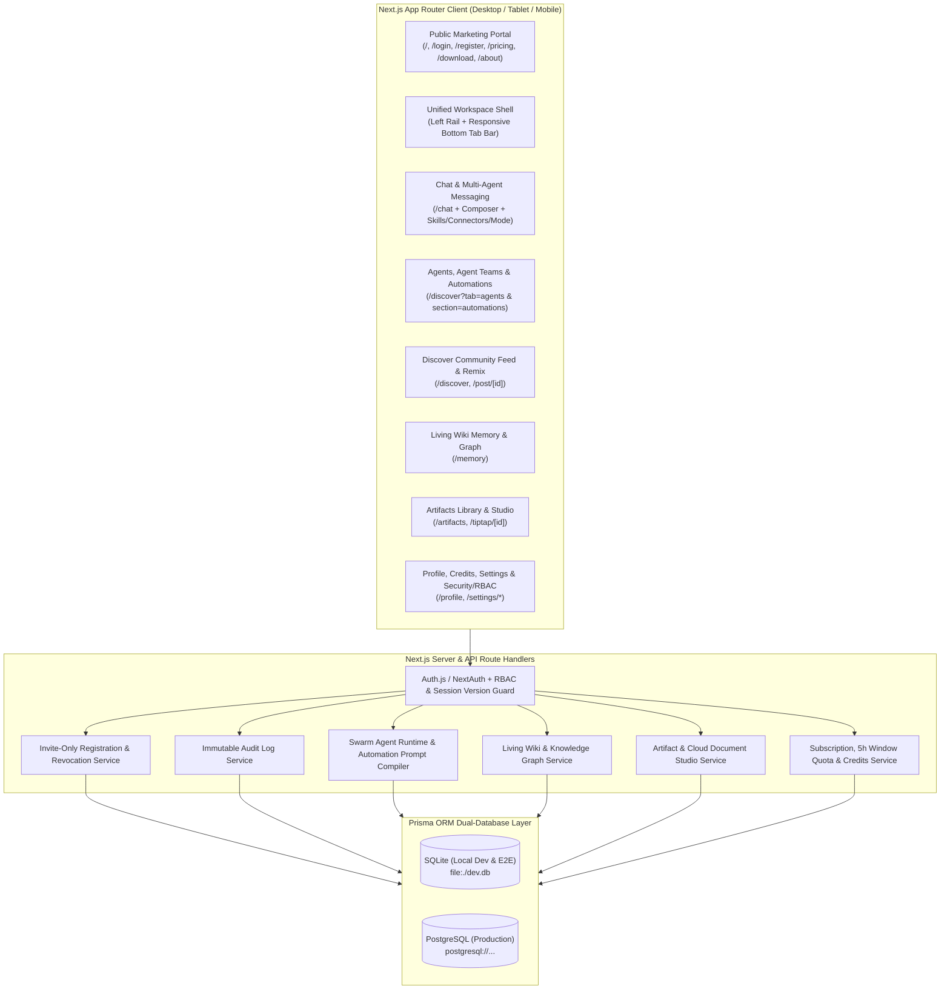
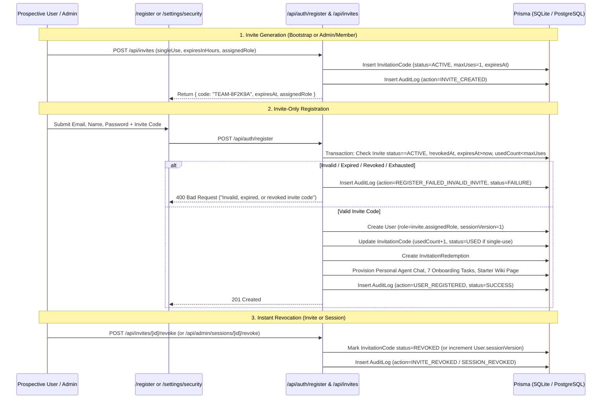

# Architecture & Data Model — Teamily AI

## 1. High-Level System Architecture

---

## 2. Authentication, Invite-Only Registration & Revocation Flow

---

## 3. Complete Entity-Relationship & Prisma Data Model

### 3.1 Core Security, Users, Invitations, Sessions & Audit Entities

- **`User`**:
  - `id` (String, CUID/UUID PK)
  - `email` (String, Unique)
  - `passwordHash` (String)
  - `name` (String)
  - `handle` (String, Unique, e.g., `@joshuah`)
  - `avatar` (String?)
  - `role` (String: `'ADMIN' | 'MODERATOR' | 'MEMBER' | 'VIEWER'`, default `'MEMBER'`)
  - `status` (String: `'ACTIVE' | 'SUSPENDED' | 'REVOKED'`, default `'ACTIVE'`)
  - `sessionVersion` (Int, default `1` — incremented on global session revocation)
  - `bio`, `tags`, `gender`, `location`, `website`, `company`, `githubUrl`, `xUserName`, `telegramUserName`
  - `lifeGoalsJson` (String — JSON storing `health`, `finance`, `career`, `hobbies`, `family`, `productivity`, `other`)
  - `planCode` (String: `'FREE' | 'PLUS' | 'PREMIUM' | 'PRO'`, default `'FREE'`)
  - `creditsCents` (Int, default `0`)
  - `windowCreditsRemaining` (Int, default `500`)
  - `monthlyCreditsUsed` (Int, default `0`)
  - `monthlyCreditsTotal` (Int, default `1500000`)
  - `streakDays` (Int, default `1`)
  - `preferencesJson` (String — theme, language, linkPreviews, taskAlerts, messageFolding)
  - `createdAt`, `updatedAt`

- **`UserSession`**:
  - `id` (String, PK)
  - `userId` (String, FK -> `User`)
  - `sessionToken` (String, Unique)
  - `ipAddress` (String?)
  - `userAgent` (String?)
  - `isRevoked` (Boolean, default `false`)
  - `revokedAt` (DateTime?)
  - `revokedById` (String?)
  - `expiresAt` (DateTime)
  - `lastActiveAt` (DateTime)
  - `createdAt` (DateTime)

- **`InvitationCode`**:
  - `id` (String, PK)
  - `code` (String, Unique, indexed)
  - `createdById` (String?, FK -> `User` — nullable for CLI/bootstrap codes)
  - `assignedRole` (String: `'ADMIN' | 'MODERATOR' | 'MEMBER' | 'VIEWER'`, default `'MEMBER'`)
  - `maxUses` (Int, default `1` for single-use)
  - `usedCount` (Int, default `0`)
  - `boundEmail` (String? — optional restriction to a specific email)
  - `note` (String?)
  - `status` (String: `'ACTIVE' | 'USED' | 'EXPIRED' | 'REVOKED'`, default `'ACTIVE'`)
  - `expiresAt` (DateTime?)
  - `revokedAt` (DateTime?)
  - `revokedById` (String?, FK -> `User`)
  - `createdAt`, `updatedAt`

- **`InvitationRedemption`**:
  - `id` (String, PK)
  - `invitationId` (String, FK -> `InvitationCode`)
  - `redeemedById` (String, FK -> `User`)
  - `rewardCents` (Int, default `100`)
  - `ipAddress` (String?)
  - `redeemedAt` (DateTime)

- **`AuditLog`**:
  - `id` (String, PK)
  - `actorId` (String?, FK -> `User`)
  - `actorEmail` (String?)
  - `actorRole` (String?)
  - `action` (String, indexed — e.g., `INVITE_CREATED`, `INVITE_REDEEMED`, `INVITE_REVOKED`, `REGISTER_FAILED_INVALID_INVITE`, `USER_REGISTERED`, `USER_LOGIN`, `USER_ROLE_UPDATED`, `SESSION_REVOKED`, `API_CLIENT_REVOKED`, `AGENT_CREATED`, `AUTOMATION_EXECUTED`, `WIKI_PAGE_CREATED`, `ARTIFACT_CREATED`, `POST_PUBLISHED`)
  - `targetType` (String — `INVITE`, `USER`, `SESSION`, `AGENT`, `CONVERSATION`, `WIKI`, `ARTIFACT`, `POST`, `SETTINGS`)
  - `targetId` (String?)
  - `status` (String — `'SUCCESS' | 'FAILURE'`)
  - `metadataJson` (String — structured details)
  - `ipAddress` (String?)
  - `userAgent` (String?)
  - `createdAt` (DateTime, indexed)

---

### 3.2 Workspace, Chat, Agents, Automations, Feed, Wiki & Artifacts Entities

- **`Agent`**:
  - `id` (String, PK)
  - `slug` (String, Unique)
  - `name` (String)
  - `description` (String)
  - `systemPrompt` (String)
  - `category` (String — e.g., `Engineering`, `Finance`, `Research`, `Marketing`, `Product`, `Design`, `Life`)
  - `modelName` (String, default `'Qwen3-32B'`)
  - `avatarUrl` (String)
  - `isOfficial` (Boolean, default `false`)
  - `isDefaultPersonal` (Boolean, default `false`)
  - `skillsJson` (String — array of enabled skill slugs)
  - `connectorsJson` (String — array of enabled connector slugs)
  - `creatorId` (String?, FK -> `User`)
  - `usersCount` (String, default `'1.2K+'`)
  - `rating` (String, default `'5.0'`)
  - `createdAt`, `updatedAt`

- **`Conversation`**:
  - `id` (String, PK)
  - `title` (String)
  - `type` (String: `'PERSONAL_AGENT' | 'DIRECT_AGENT' | 'GROUP' | 'DIRECT_USER'`)
  - `ownerId` (String, FK -> `User`)
  - `agentId` (String?, FK -> `Agent`)
  - `isPinned` (Boolean, default `false`)
  - `isMuted` (Boolean, default `false`)
  - `autoTranslate` (Boolean, default `false`)
  - `paymentMode` (String: `'MEMBERS_PAY' | 'OWNER_PAYS'`, default `'MEMBERS_PAY'`)
  - `teamCategory` (String?)
  - `lastMessageText` (String?)
  - `lastMessageAt` (DateTime)
  - `createdAt`, `updatedAt`

- **`ConversationMember`**:
  - `id` (String, PK)
  - `conversationId` (String, FK -> `Conversation`)
  - `memberType` (String: `'USER' | 'AGENT'`)
  - `userId` (String?, FK -> `User`)
  - `agentId` (String?, FK -> `Agent`)
  - `displayName` (String)
  - `role` (String, default `'MEMBER'`)

- **`Message`**:
  - `id` (String, PK)
  - `conversationId` (String, FK -> `Conversation`)
  - `senderType` (String: `'USER' | 'AGENT' | 'SYSTEM'`)
  - `senderUserId` (String?, FK -> `User`)
  - `senderAgentId` (String?, FK -> `Agent`)
  - `senderName` (String)
  - `content` (String)
  - `agentMode` (String: `'Auto' | 'Instant' | 'Agentic'`, default `'Auto'`)
  - `skillsUsedJson` (String)
  - `connectorsUsedJson` (String)
  - `promptsJson` (String — interactive follow-up prompt suggestions)
  - `reactionsJson` (String — map of emoji -> userIds)
  - `artifactId` (String? — linked generated artifact)
  - `createdAt` (DateTime)

- **`Automation`**:
  - `id` (String, PK)
  - `userId` (String, FK -> `User`)
  - `templateSlug` (String)
  - `title` (String)
  - `category` (String: `'Work' | 'Life'`)
  - `intent` (String: `'Research' | 'Monitor' | 'Create' | 'Analyze' | 'Plan' | 'Coordinate'`)
  - `schedule` (String: `'Run now' | 'Later' | 'Daily' | 'Weekly'`)
  - `teamJson` (String)
  - `scope` (String: `'One-shot' | 'Recurring'`)
  - `compiledPrompt` (String)
  - `status` (String: `'ACTIVE' | 'PAUSED' | 'COMPLETED'`)
  - `lastRunAt` (DateTime?)
  - `lastResult` (String?)
  - `createdAt`, `updatedAt`

- **`WikiPage`**:
  - `id` (String, PK)
  - `userId` (String, FK -> `User`)
  - `title` (String)
  - `summary` (String)
  - `content` (String)
  - `category` (String, default `'Getting Started'`)
  - `tagsJson` (String)
  - `status` (String: `'published' | 'conflict' | 'draft'`, default `'published'`)
  - `version` (Int, default `1`)
  - `isNew` (Boolean, default `true`)
  - `createdByKind` (String: `'human' | 'agent'`, default `'human'`)
  - `referencesJson` (String — graph edges to other WikiPage IDs)
  - `createdAt`, `updatedAt`

- **`Artifact`**:
  - `id` (String, PK)
  - `userId` (String, FK -> `User`)
  - `title` (String)
  - `workspaceType` (String: `'tiptap' | 'website' | 'whiteboard' | 'slides' | 'dashboard' | 'media'`)
  - `category` (String: `'Documents' | 'Websites' | 'Media' | 'Messages' | 'Meetings'`)
  - `content` (String)
  - `starred` (Boolean, default `false`)
  - `originKind` (String: `'blank' | 'chat' | 'automation' | 'remix'`)
  - `createdAt`, `updatedAt`

- **`CommunityPost`**:
  - `id` (String, PK)
  - `authorId` (String?, FK -> `User`)
  - `authorName` (String)
  - `authorHandle` (String)
  - `agentName` (String, default `'Super Agent'`)
  - `title` (String)
  - `description` (String)
  - `prompt` (String)
  - `category` (String: `'Webpage' | 'Slides' | 'Dashboard' | 'Article' | 'Mini Game' | 'Mini App' | 'Productivity' | 'AI & Tech'`)
  - `previewHtml` (String)
  - `likesCount` (Int, default `0`)
  - `savesCount` (Int, default `0`)
  - `commentsJson` (String)
  - `createdAt`, `updatedAt`

- **`OnboardingTask`**:
  - `id` (String, PK)
  - `userId` (String, FK -> `User`)
  - `taskCode` (String)
  - `name` (String)
  - `rewardCents` (Int, default `100`)
  - `completed` (Boolean, default `false`)
  - `completedAt` (DateTime?)

- **`UserIntegration`** (Connectors, Channels, Runtimes, Skill Keys & Authorized API Clients):
  - `id` (String, PK)
  - `userId` (String, FK -> `User`)
  - `kind` (String: `'CONNECTOR' | 'CHANNEL' | 'RUNTIME' | 'SKILL_KEY' | 'API_CLIENT' | 'MCP_SERVER'`)
  - `slug` (String)
  - `name` (String)
  - `status` (String: `'CONNECTED' | 'DISCONNECTED' | 'REVOKED'`)
  - `configJson` (String)
  - `createdAt`, `updatedAt`
